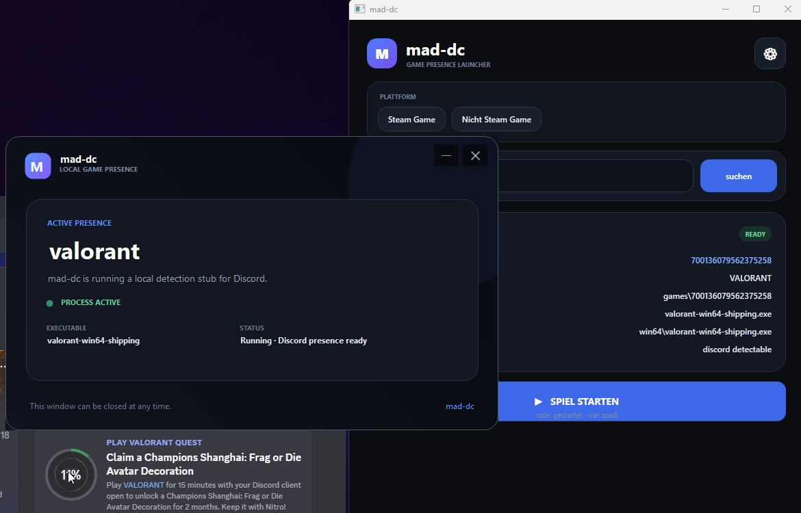

# mad-dc

> **Game Presence Launcher for Windows**  
> Search for a game, resolve its executable information, and launch a local process stub that can be detected by Discord as the selected game.



---

## Table of Contents

- [Overview](#overview)
- [How It Works](#how-it-works)
- [Normal Application vs Stub EXE](#normal-application-vs-stub-exe)
- [Steam Games](#steam-games)
- [Non-Steam Games](#non-steam-games)
- [Installation](#installation)
- [Usage](#usage)
- [Stub Location](#stub-location)
- [Generated Game Structure](#generated-game-structure)
- [Architecture](#architecture)
- [Requirements](#requirements)
- [Build From Source](#build-from-source)
- [Configuration](#configuration)
- [Troubleshooting](#troubleshooting)
- [Proof](#proof)
- [Project Structure](#project-structure)
- [Disclaimer](#disclaimer)

---

## Overview

**mad-dc** is a Windows desktop application designed to create a local game process that can be detected by Discord's game/activity detection.

The application provides two modes:

- **Steam Game** — resolves Steam game information and prepares the corresponding Steam-style installation structure.
- **Nicht Steam Game** — resolves non-Steam game information and uses a Windows executable name for the local detection process.

The important part is the separation between the **normal launcher application** and the **stub executable**.

The launcher handles searching, configuration, game information and launching.

The stub is the process that actually runs under the selected game's executable name.

---

## How It Works

The basic flow is:

```text
┌──────────────────────┐
│       mad-dc         │
│   Normal Launcher    │
└──────────┬───────────┘
           │
           │ Search game
           ▼
┌──────────────────────┐
│   Game Information   │
│  Name / ID / EXE     │
└──────────┬───────────┘
           │
           │ Prepare local files
           ▼
┌──────────────────────┐
│     Stub EXE         │
│ renamed to target EXE │
└──────────┬───────────┘
           │
           │ Start process
           ▼
┌──────────────────────┐
│ Windows Process      │
│ with game EXE name   │
└──────────┬───────────┘
           │
           ▼
       Discord
    game detection
```

The stub does not need to contain the actual game.

Its purpose is to provide a running Windows process with the executable name associated with the selected game.

---

## Normal Application vs Stub EXE

### `mad-dc.exe`

This is the **normal application**.

It is responsible for:

- displaying the user interface
- searching for games
- resolving game metadata
- selecting Steam or non-Steam mode
- reading and saving configuration
- preparing the required directories/files
- extracting the embedded stub
- creating the target executable path
- launching the stub
- showing the detected game information

You normally start **`mad-dc.exe`**.

---

### `mad-dc-stub.exe`

The **stub** is a small standalone executable used as the actual game-process replacement.

The launcher stores the original stub in:

```text
%APPDATA%\mad-dc\mad-dc-stub.exe
```

When a game is launched, mad-dc creates a copy of the stub at the selected executable path and gives that copy the game's executable filename.

For example:

```text
mad-dc-stub.exe
        ↓
valorant-win64-shipping.exe
```

or:

```text
mad-dc-stub.exe
        ↓
Roblox.exe
```

The process therefore runs with the target executable name.

### Important

The stub is **not the real game**.

It does not download, install or emulate the game itself.

It exists to provide the local process that Discord can detect.

---

## Steam Games

When **Steam Game** is selected, mad-dc resolves the Steam application information and prepares the selected game directory.

The Steam manifest is intentionally placed **inside the generated game directory**.

Example:

```text
Steam
└── steamapps
    └── common
        └── HeavenlyTrouble
            ├── appmanifest_2924520.acf
            └── bin
                └── BrahmaFinal.exe
```

The executable path can therefore contain subdirectories.

For example:

```text
bin/BrahmaFinal.exe
```

The launcher creates the required directories before copying the stub.

---

## Non-Steam Games

For **Nicht Steam Game**, mad-dc does not use Steam's installation structure.

Instead, the application resolves information for the selected game and requires a Windows executable name.

Only Windows executables are accepted.

Examples:

```text
Roblox.exe
valorant-win64-shipping.exe
Game.exe
```

macOS bundle names such as:

```text
Roblox.app
Game.app
```

are ignored.

The application is intended to create/use a Windows `.exe` process only.

---

## Installation

### Option 1 — Release Build

Download the latest release and extract it to a folder of your choice.

Then run:

```text
mad-dc.exe
```

No separate .NET installation is required when using a self-contained release.

---

### Option 2 — Build From Source

Clone the repository:

```bash
git clone https://github.com/YOUR-USERNAME/mad-dc.git
cd mad-dc
```

Restore dependencies:

```bash
dotnet restore
```

Build:

```bash
dotnet build -c Release
```

Create the self-contained Windows release:

```bash
dotnet publish -c Release -r win-x64 --self-contained true /p:PublishSingleFile=true /p:IncludeNativeLibrariesForSelfExtract=true
```

The resulting executable can be found inside the publish directory.

---

## Usage

### 1. Start mad-dc

Launch:

```text
mad-dc.exe
```

### 2. Select a platform

Choose:

- `Steam Game`
- `Nicht Steam Game`

### 3. Search for a game

Enter the game name and press:

```text
suchen
```

### 4. Check the resolved information

The result card displays information such as:

- Steam ID
- game name
- installation directory
- executable name
- executable path
- metadata source

### 5. Launch

Press:

```text
SPIEL STARTEN
```

mad-dc prepares the required files and starts the local process.

### 6. Discord detection

If Discord detects the process, the selected game can appear as the active game/activity.

---

## Stub Location

The original embedded stub is extracted to:

```text
%APPDATA%\mad-dc\mad-dc-stub.exe
```

On a typical Windows installation this resolves to something similar to:

```text
C:\Users\<Username>\AppData\Roaming\mad-dc\mad-dc-stub.exe
```

The launcher keeps this file as the source copy.

Game-specific executable copies are created separately.

---

## Generated Game Structure

### Steam

A Steam game may result in a structure similar to:

```text
Steam\steamapps\common\<InstallDir>\
├── appmanifest_<APPID>.acf
└── <game executable path>
```

Example:

```text
Steam\steamapps\common\HeavenlyTrouble\
├── appmanifest_2924520.acf
└── bin\
    └── BrahmaFinal.exe
```

### Non-Steam

Non-Steam games do not require the Steam manifest structure.

The launcher instead creates the required executable path for the local process.

---

## Architecture

mad-dc consists of two main parts.

### Launcher

The main WPF application handles:

```text
UI
 ├── Platform selection
 ├── Search
 ├── Settings
 ├── Game information
 └── Launch

Game resolver
 ├── Steam
 └── Non-Steam

Process preparation
 ├── Directory creation
 ├── Stub extraction
 ├── Executable copy
 └── Process start
```

### Stub

The stub is a lightweight Windows executable.

Its job is intentionally simple:

```text
Start
  ↓
Create local process
  ↓
Display status UI
  ↓
Remain running
  ↓
Discord can inspect the process
```

The stub is independent from the main launcher's WPF interface.

---

## Requirements

### Runtime

For users:

- Windows 10/11
- x64 recommended

A self-contained release includes the required .NET runtime.

### Development

For building from source:

- Windows
- .NET 8 SDK
- Visual Studio 2022 or another compatible C# IDE

---

## Configuration

mad-dc stores its configuration in the user's profile.

The application can store values such as the configured Steam library and SteamApps locations.

The default Steam locations are based on the standard Steam installation:

```text
C:\Program Files (x86)\Steam\steamapps\common
```

and:

```text
C:\Program Files (x86)\Steam\steamapps
```

Custom paths can be configured through the settings interface.

---

## Troubleshooting

### The game cannot be found

Check:

- the game name
- the selected platform
- your internet connection
- whether the metadata source is currently reachable

### Roblox resolves to `Roblox.app`

This indicates a macOS entry was returned by the metadata source.

The Windows resolver should ignore `.app` entries and select a Windows `.exe`, such as:

```text
Roblox.exe
```

### The stub does not start

Check:

```text
%APPDATA%\mad-dc\
```

The directory should contain:

```text
mad-dc-stub.exe
```

If the file is missing, restart mad-dc so the embedded stub can be extracted again.

### Discord does not show the game

Discord's game detection is external to mad-dc.

Make sure:

- Discord is running
- the generated process is still running
- Discord's activity/game detection is enabled
- the executable name matches a detectable game entry

Detection behavior can change independently of mad-dc.

---

## Proof

The included screenshot demonstrates the application running with the stub process active and the selected game information displayed.

The proof shows:

- mad-dc running
- the selected game
- active process status
- executable information
- Discord-related detection information
- the launcher UI


---

## Project Structure

A typical repository layout:

```text
mad-dc/
├── mad-dc.cs
├── mad-dc.csproj
├── app.manifest
├── mad-dc-stub/
│   └── Program.cs
├── README.md
└── Discord_JotSL2tVdI.png
```

The exact source layout may vary between releases.

---

## Security & Privacy

mad-dc is designed to run locally.

The stub does not represent or contain the actual game.

The launcher creates local files and processes required for the selected game configuration.

Always review third-party code and releases before running software on your system.

---

## Disclaimer

mad-dc is an independent third-party project and is not affiliated with, endorsed by, or sponsored by Discord, Valve, Steam, Riot Games, Roblox Corporation, or other referenced game/platform publishers.

Game and platform names are used only to identify the corresponding software.

Use the application responsibly and in accordance with the terms and policies of the services you use.

---

## License

Add the project's license here, for example:

```text
MIT License
```

if the repository is intended to be released under MIT.

---

<p align="center">
  <sub>mad-dc · Game Presence Launcher</sub>
</p>
